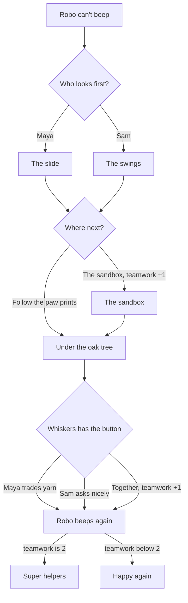

# Robo's Lost Beep

A short interactive story for young players, starring Maya, Sam, Robo the robot and Whiskers the cat. Robo's beep button is missing, and the player helps Maya and Sam find it. It takes about three minutes to play and has three choices and two endings. The whole story is in `tales/robos_lost_beep.tale`, and a test (`tests/unit/integration/test_robos_lost_beep.gd`) plays every route.

It uses the Studio's starter characters and backgrounds (`studio/library/art`), so it is also the sample story the Studio opens with.

## The characters

| Character | Moods |
|---|---|
| Maya | neutral, happy, sad, surprised, thinking |
| Sam | neutral, happy, sad, surprised, thinking |
| Robo | neutral, happy, sad, surprised, thinking |
| Whiskers | neutral, happy, sad, surprised, thinking |

## How the story branches

Digging through the sandbox together and getting the button back together each add one point of teamwork. With both, Robo beeps Maya's and Sam's names in the Super helpers ending.

## Play it in StoryTeller (Godot)

1. Open this repository's project in Godot 4.7.
2. In the FileSystem dock, open `examples/robos_lost_beep/main.tscn`.
3. Press **Run Current Scene** (F6). The title screen opens; press **New Game**.

The example has its own `story_config.tres`. It keeps its saves and settings apart from the main demo's (`save_folder` and `settings_path`). The Story tab checks `robos_lost_beep.tale` against this config, so it knows Maya, Sam, Robo and Whiskers.

## The TaleScript in this story

| What happens | TaleScript |
|---|---|
| Show a backdrop | `backdrop("forest")` |
| Bring in a character | `maya.enter("happy", at = LEFT)` |
| A line of dialogue | `sam: "Look! It's Whiskers!"` |
| A line with a new mood | `maya (surprised): "Robo said our names!"` |
| Narration | `"The end."` |
| A variable | `var teamwork := 0` |
| Add to it | `teamwork += 1` |
| A choice | `choose:` with an indented line for each option |
| A scene | `beat sandbox:` |
| Go to a scene | `jump sandbox` |
| Branch on a variable | `if teamwork >= 2:` |
| Shake a character | `robo.shake()` |
| Hide one character | `whiskers.exit()` |
| Hide everyone | `exit_all()` |

## Ideas for students

- Add a third place to search in the "Where next?" choice.
- Give Robo a new mood, such as sleepy, and use it in an ending.
- Add a third ending for when teamwork is 0.
- Swap in your own drawings: keep the file names, and the story picks them up.

## Making the art again

The characters and backgrounds are the Studio's starter library, drawn by `tools/demo_assets/starter_library.py`. Run it from the repository root with `python3 tools/demo_assets/starter_library.py` (needs Pillow and NumPy).
