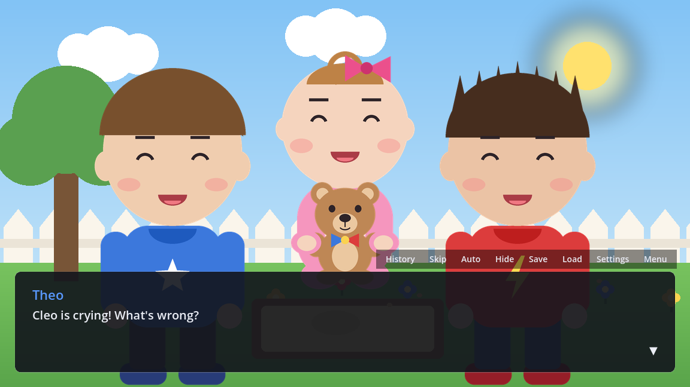
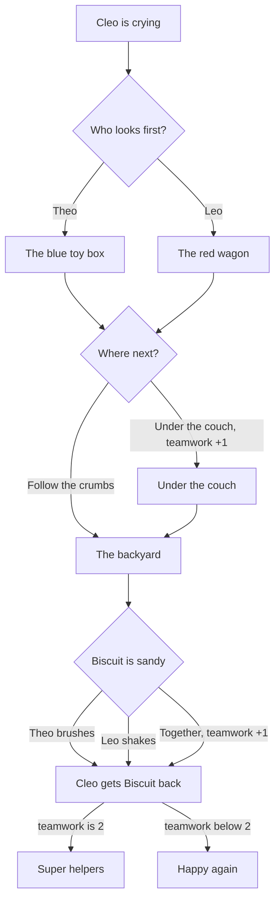

# Where's Biscuit?

A short interactive story for young players, starring Theo, Leo and baby Cleo. Cleo's teddy bear Biscuit is missing, and the player helps Theo and Leo find the bear. It takes about three minutes to play and has three choices and two endings. The whole story is in `tales/wheres_biscuit.tale`, and a test (`tests/unit/integration/test_wheres_biscuit.gd`) plays every route.

## The characters

| Character | Color | Moods |
|---|---|---|
| Theo | blue | neutral, happy, sad, surprised, thinking |
| Leo | red | neutral, happy, sad, surprised, thinking |
| Cleo | pink | neutral, happy, sad, surprised, hug (holding Biscuit) |
| Biscuit | brown | neutral |

## How the story branches

Lifting the couch together and cleaning Biscuit together each add one point of teamwork. With both, Cleo says Theo's and Leo's names in the Super helpers ending.

## Play it in StoryTeller (Godot)

1. Open this repository's project in Godot 4.7.
2. In the FileSystem dock, open `examples/wheres_biscuit/main.tscn`.
3. Press **Run Current Scene** (F6). The title screen opens; press **New Game**.

The example has its own `story_config.tres`. It keeps its saves and settings apart from the main demo's (`save_folder` and `settings_path`). The Story tab checks `wheres_biscuit.tale` against this config, so it knows Theo, Leo, Cleo and Biscuit.

## The TaleScript in this story

| What happens | TaleScript |
|---|---|
| Show a backdrop | `backdrop("backyard")` |
| Bring in a character | `theo.enter("happy", at = LEFT)` |
| A line of dialogue | `theo: "It's Biscuit!"` |
| A line with a new mood | `leo (surprised): "Look!"` |
| Narration | `"The end."` |
| A variable | `var teamwork := 0` |
| Add to it | `teamwork += 1` |
| A choice | `choose:` with an indented line for each option |
| A scene | `beat couch:` |
| Go to a scene | `jump couch` |
| Branch on a variable | `if teamwork >= 2:` |
| Shake a character | `cleo.shake()` |
| Hide one character | `biscuit.exit()` |
| Hide everyone | `exit_all()` |

## Ideas for students

- Add a third place to search in the "Where next?" choice.
- Give Cleo a new mood, such as sleepy, and use it in an ending.
- Add a third ending for when teamwork is 0.
- Swap in your own drawings: keep the file names, and the story picks them up.

## Making the art again

All the pictures are drawn by `tools/demo_assets/wheres_biscuit.py`. Run it from the repository root with `python3 tools/demo_assets/wheres_biscuit.py` (needs Pillow and NumPy). To use your own art, replace the PNG files with pictures of the same names.
